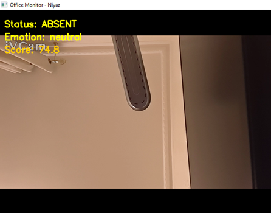
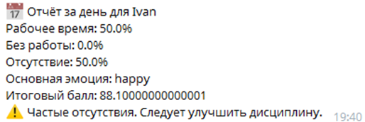

# 🖥️ Экспертная система интеллектуального мониторинга активности сотрудников

Веб-ориентированная экспертная система компьютерного зрения (Computer Vision), предназначенная для автоматического контроля присутствия сотрудника на рабочем месте, анализа его вовлеченности и распознавания эмоционального состояния в реальном времени. Система обрабатывает видеопоток, вычисляет динамический балл продуктивности (скоринг), ведет структурированные логи и отправляет автоматические отчеты руководству в Telegram.

## 🛠️ Используемые технологии и стек

* **Детекция объектов:** `YOLOv8` (модель `yolov8n.pt`) — мгновенное обнаружение сотрудника (`person`) и рабочего ноутбука (`laptop`) в кадре.
* **Анализ выражений лица:** `DeepFace` — нейросетевой фреймворк для циклического определения доминантной эмоции сотрудника (обновление каждые 10 секунд для исключения фризов видеопотока).
* **Обработка данных:** `Pandas` — асинхронное журналирование метрик и логирование состояний в локальные хранилища.
* **Канал уведомлений:** `Telegram Bot API` — мгновенные оповещения HR-специалистов о нарушениях регламента и отправка финальной аналитики.

## 🚀 Правила экспертной системы и начисление баллов

Логическое ядро системы ежесекундно сопоставляет обнаруженные нейросетью триггеры и переключает статусы активности:

* **`WORKER_PRESENT`** 🟢 Сотрудник и ноутбук находятся в кадре одновременно. Фиксируется активная работа, начисляется бонус вовлеченности (`+0.1` балла/мин).
* **`NONWORKING`** 🟡 Сотрудник в кадре есть, но рабочий инструмент (ноутбук) отсутствует. Фиксируется простой, применяется штраф (`-0.1` балла/мин).
* **`ABSENT`** 🔴 Рабочее место полностью пусто. Фиксируется отсутствие, балл дисциплины снижается (`-0.2` балла/мин).

### ⚠️ Автоматическая фиксация нарушений
Если статус **`ABSENT`** непрерывно длится более `120 секунд` (2 минуты), система генерирует экстренное пуш-уведомление в Telegram руководителю и списывает фиксированный штраф в размере `-5.0` баллов.

## 📸 Интерфейс приложения / Скриншоты

<details>
<summary><b>Нажмите, чтобы открыть скриншоты (Click to expand)</b></summary>

### 📈 Мониторинг видеопотока в реальном времени (OpenCV)


### 📅 Ежедневный автоматический HR-отчет в Telegram


</details>

---

## 💻 Локальный запуск проекта

1. Клонируйте репозиторий:
   ```bash
   git clone https://github.com
   cd employee-activity-expert-system
   ```

2. Установите зависимости:
   ```bash
   pip install -r requirements.txt
   ```

3. Настройте файл токенов `.env` и запустите систему мониторинга:
   ```bash
   python monitor.py
   ```
